# Tempo: pitch deck

The 15-slide presentation for **Tempo**, an AI study planner for high-school students, built for the **AI for Student Life** competition (RIT Dubai).

- **Download:** [`Tempo-Pitch-Deck.pptx`](Tempo-Pitch-Deck.pptx) (PowerPoint, with speaker notes) · [`Tempo-Pitch-Deck.pdf`](Tempo-Pitch-Deck.pdf)
- **The app:** https://tempo-study-planner.netlify.app
- **The code:** https://github.com/hexa3/tempo

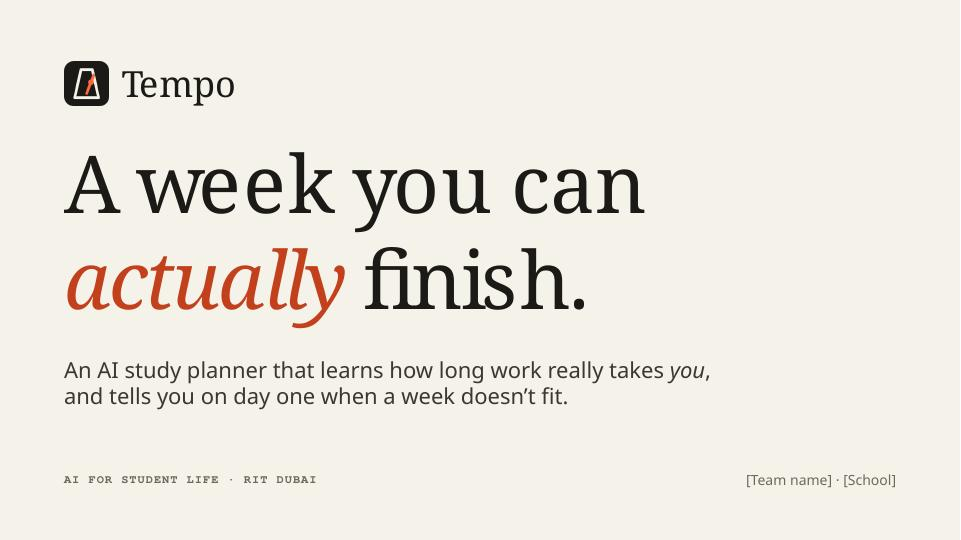

## Slides

| # | Slide | Rubric area |
|---|---|---|
| 1 | Cover: "A week you can *actually* finish." | |
| 2 | No planner tells you if your week fits: we underestimate, we cram, we find out too late | Problem |
| 3 | Who it's for: each student need matched to a design decision | Problem |
| 4 | Tell, Check, Plan, Adapt | Prototype |
| 5 | Live demo: the judges' week, plus the 7 demo steps | Prototype |
| 6 | Four jobs, and the right kind of AI for each | AI thinking |
| 7 | Three engines, one switch (Local AI, Groq, offline rules), with measured speeds | AI thinking |
| 8 | The AI never has the last word: how Tempo checks the AI | AI thinking |
| 9 | Learning your pace: the prediction formula and a live example | AI thinking |
| 10 | Why a chatbot doesn't write the schedule | AI thinking |
| 11 | We tested it, and it broke: the local model's real mistakes, before and after | Testing |
| 12 | 22 tests · 7/7 judge scenarios · 9 test stories · 2.4 s on the live site | Testing |
| 13 | Responsible design | Responsible AI |
| 14 | What still needs work, and next steps | Testing |
| 15 | Try it now | |

Every slide has **speaker notes** with timings for the 5-minute talk. In PowerPoint, open View → Notes.

All slides

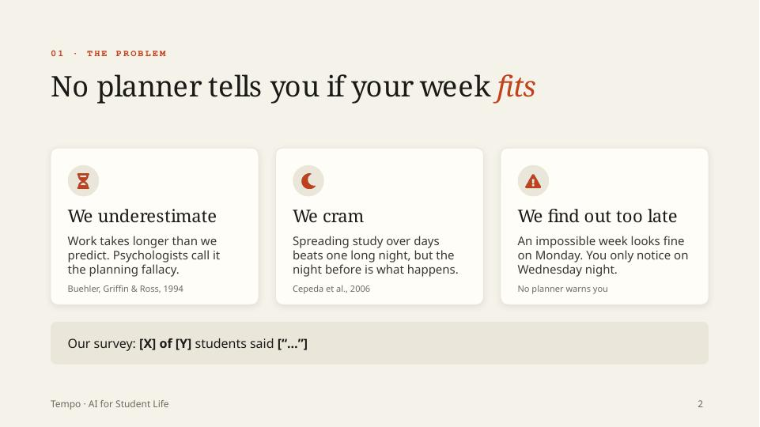
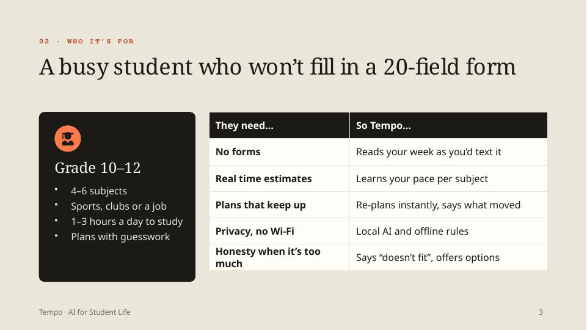
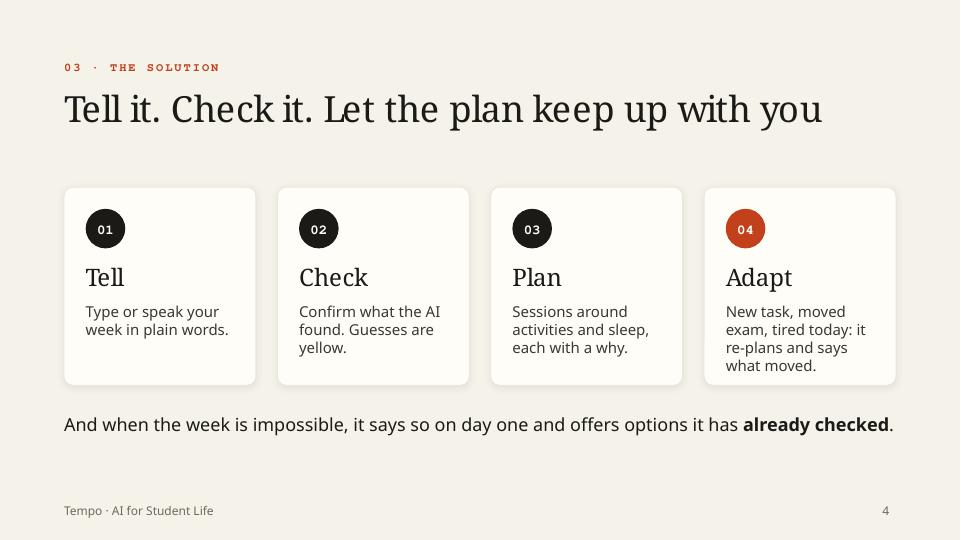
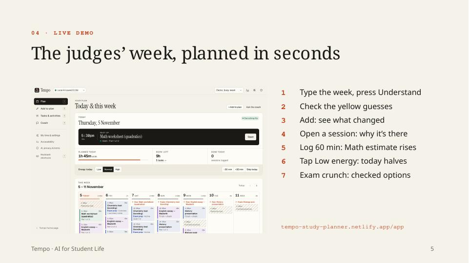
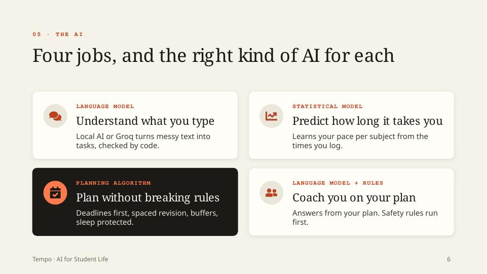
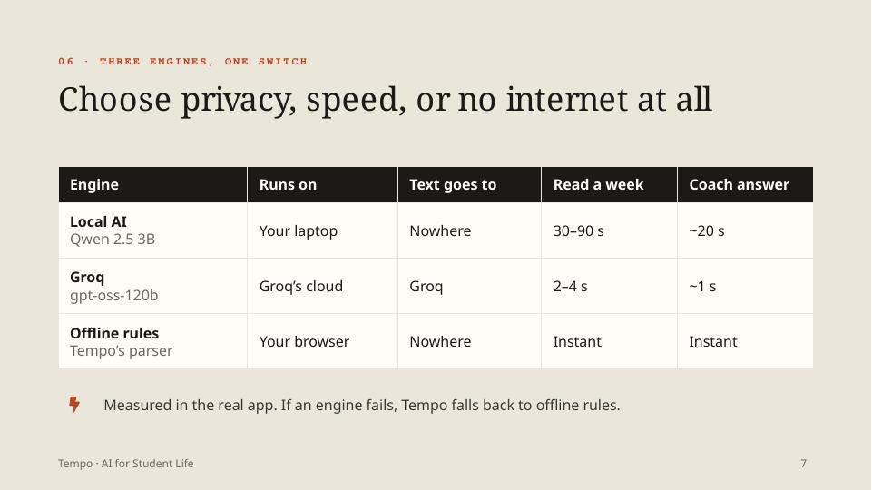
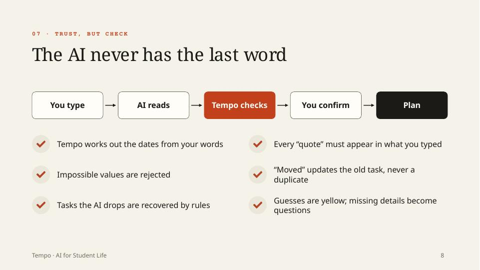
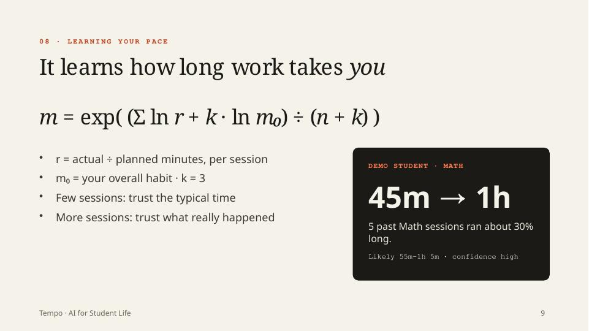
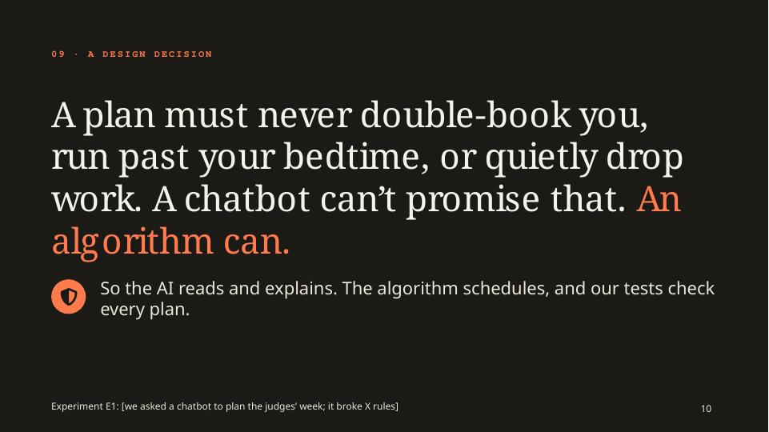
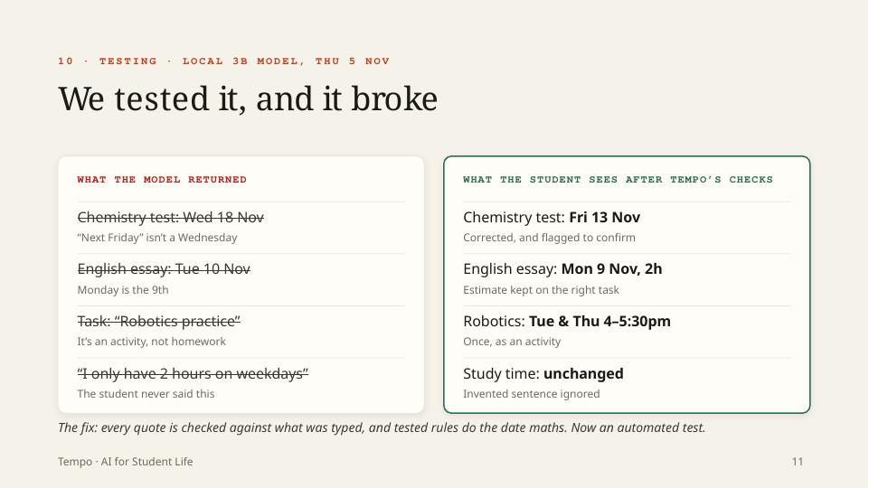
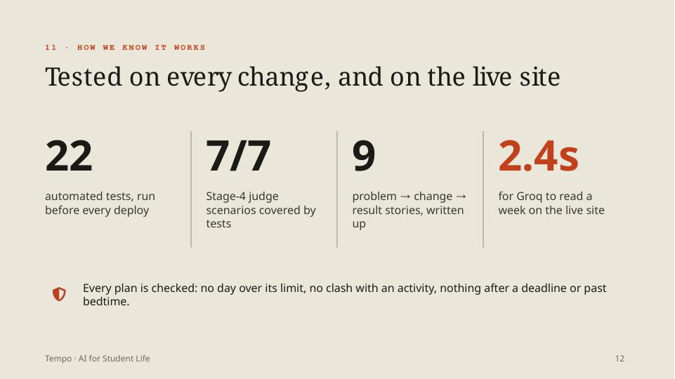
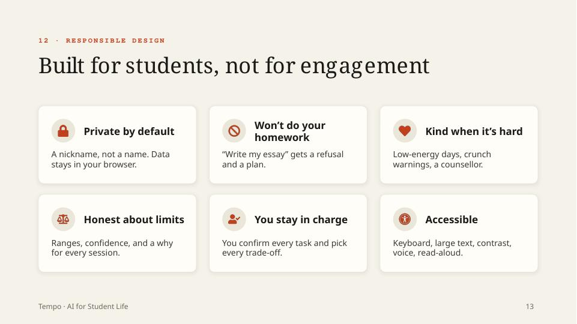
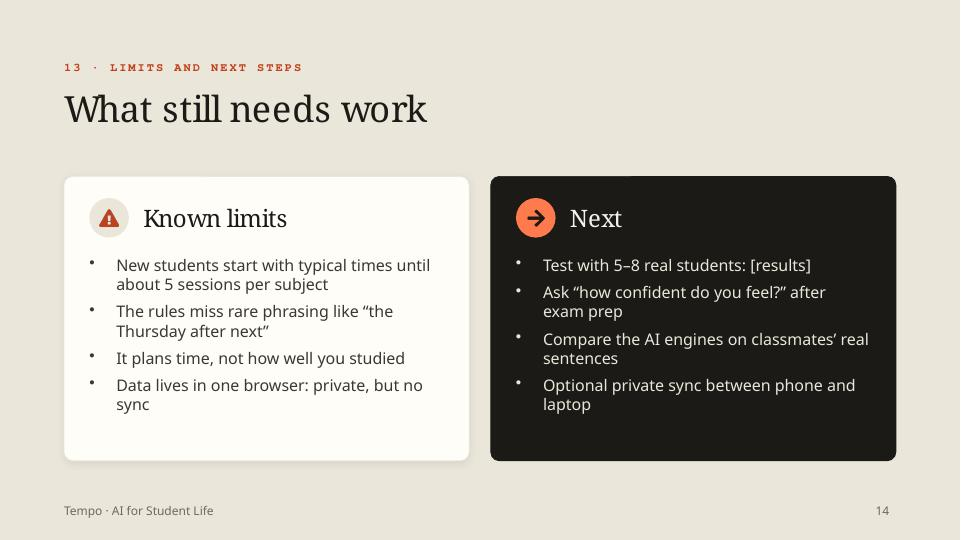
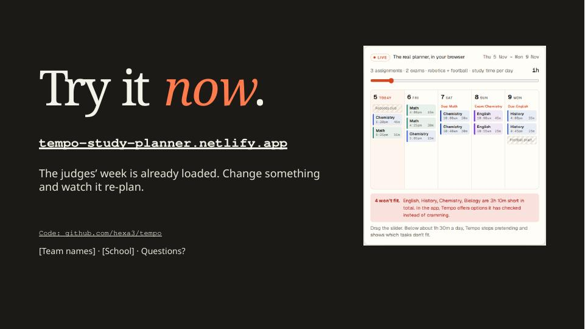

## Before presenting: fill in the placeholders

| Slide | Placeholder |
|---|---|
| 1, 15 | `[Team name]` / `[Team names]` · `[School]` |
| 2 | `Our survey: [X] of [Y] students said […]`: your real survey numbers and one quote |
| 10 | `Experiment E1: […]`: ask a chatbot to plan the judges' week and count the rules it broke (see `docs/AI_DEVELOPMENT_LOG.md` in the main repo) |
| 14 | `[results]` from testing with 5–8 real students |

## Notes
- **Fonts:** Cambria for headings and Calibri for body text. Both come with Microsoft Office, so the slides look the same on any computer. The palette matches the Tempo app: warm paper `#F5F2EA`, ink `#1B1A17`, accent `#C2401C`.
- **Screenshots** on slides 5 and 15 are from the real app. All demo data is made up.
- **Built with** [PptxGenJS](https://github.com/gitbrent/PptxGenJS); icons from [Font Awesome](https://fontawesome.com) (CC BY 4.0) via react-icons.

---

<i>Disclaimer: this README was generated by AI. I'm honestly terrible at describing my own projects (my first draft is usually just "it does the thing, trust me"), so I let a robot do the explaining.</i>

